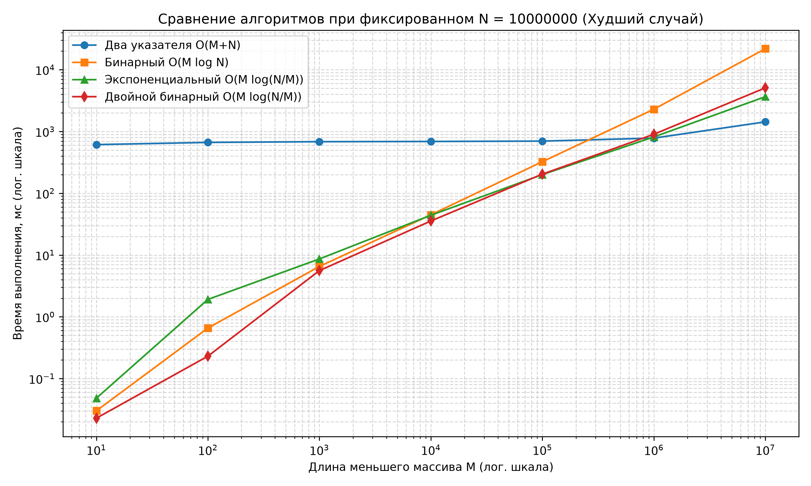
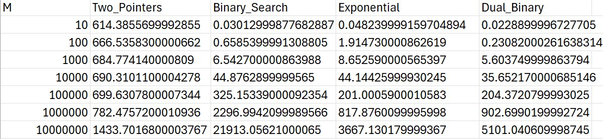

# Лабораторная работа
## Алгоритмы и структуры данных
**Выполнил студент 26ТИДИ-1, Яковлев Ярослав** 

**Цель работы:** Реализовать четыре разных решения задачи  
Выяснить при каком размере массивов какой алгоритм эффективнее.

### Ход работы: 
1. Я реализовал 4 разных алгоритма на языке Python (каждый алгоритм в разных файлах). Я проверил работоспособность этих алгоритмов на разных небольших тестах и убедился, что они работают корректно. 
2. Затем я отправил все алгоритмы в один файл, реализовал функцию для подсчета времени работы (запускал каждый тест по 10 раз и брал усредненное значение). 
3. Задал больший массив длиной 10.000.000. И экспоненциально перебирал длину меньшего массива (10, 100, 1_000, 10_000, 100_000, 1_000_000, 10_000_000). Причем для этих массивов я рассматривал худший случай для работы алгоритмов. Для тестового набора я использовал массивы с числами разной четности с равномерным распределением чисел одного массива на другой. В таком случае программа всегда выводила False.
4. Для каждого алгоритма, для каждого теста считал время, после чего добавил результаты сначала в csv – файл.
5. Затем создал графики с помощью библиотеки matplotlib и сохранил их в картинку. На графиках оси расположены следующим образом: На оси OX – размеры меньшего массива m, а на оси OY- время работы каждой программы в МС.

---

### Выводы: По итогам тестирования у меня получилась такая картина. 

   
**Что я заметил:**
1. Если длины массивов сильно различаются (M<+-100.000), то алгоритмы бинарного, экспоненциального и двойного бинарного поиска работают намного быстрее, чем метод двух указателей. Это происходит, потому что алгоритм двух указателей должен проходить через весь массив N (10.000.000 итераций).
2. В точке, где M равен приблизительно 1.000.000 время работа всех алгоритмов приблизительно равна (+-700-1000 мс).
3. Если M становится близким к N получается, что алгоритм двух указателей становится лидером по времени. 

Я рассмотрел почему так происходит, высчитав сложность:
* **а)** В классическом бинарном поиске сложность равна O(M * log2(N)), получается примерно 10 000 000 * 23.25 ≈ 232 500 000 операций.
* **б)** В экспоненциальном и двойном бинарном описке сложность равна O(M * log2(2N / M)), поэтому операций примерно 10 000 000 * 1 ≈ 10 000 000.
* **в)** Ну и в двух указателях по формуле O(M + N) получается приблизительно 20.000.000 операций.

На график отображена примерно такая же ситуация  
Получается, что выполненные тесты для худших случаев соответствуют реальности.

---

### Заключение: 
В ходе лабораторной работы были успешно реализованы и исследованы 3 алгоритма на массивах обьемом 10 млн элементов.  
Эксперимент показал, что ‘лучшего’ алгоритма не существует.  Для разных данных будут эффективны разные алгоритмы. Но в целом, можно сказать, что двойной бинарный и экспоненциальный поиски показывают себя наиболее стабильно при разных данных.
